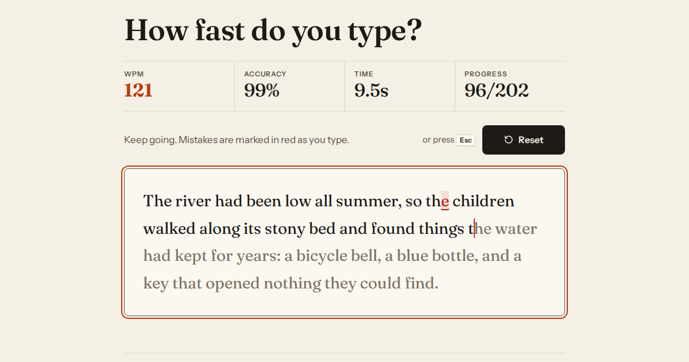
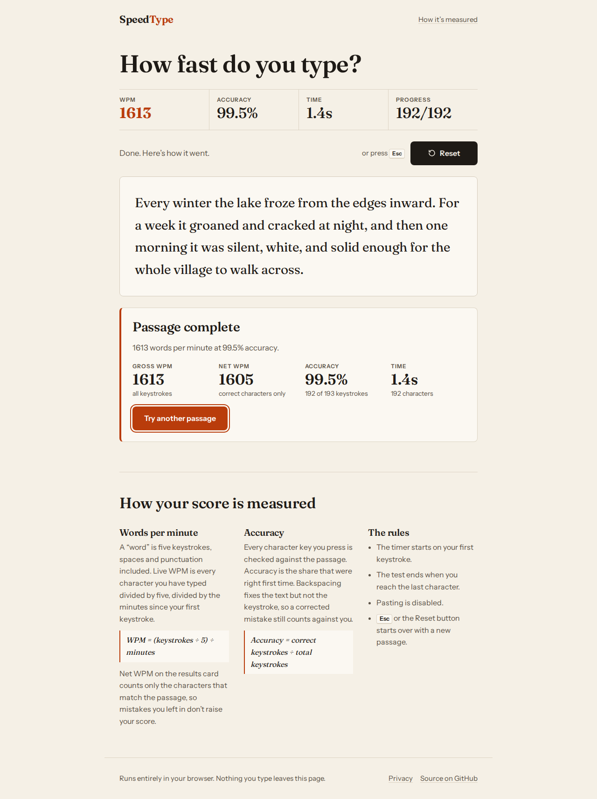
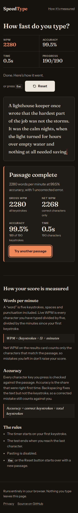

# Speed Type: Typing Speed Tracker

A typing speed test that measures your words per minute and accuracy live as you type. It runs entirely in the browser, with no sign-up, no backend and no tracking.

**Live demo:** https://typing-speed-tracker-omega.vercel.app



## Features

- **Live WPM.** Gross words per minute, recalculated on every keystroke and four times a second while you type.
- **Live accuracy.** Correct keystrokes divided by total keystrokes. A mistake you fix with Backspace still counts.
- **Per-character feedback.** Correct characters turn dark. Mistakes are marked with red text, a tinted background and an underline, so they don't rely on colour alone.
- **Instant reset.** The Reset button (or <kbd>Esc</kbd>) clears the timer, the counters and the input, and loads a new passage.
- **Results summary.** Gross WPM, net WPM (correct characters only), accuracy and time.
- **Responsive and touch-friendly.** Tap the passage to bring up the on-screen keyboard. The Reset button stays above the passage, so the keyboard never covers it.
- **Accessible.** Full keyboard use, visible focus, WCAG AA contrast in light and dark themes, results announced to screen readers, and support for reduced motion.

| Results (desktop) | Dark mode (mobile) |
| --- | --- |
|  |  |

## How scores are calculated

| Metric | Formula |
| --- | --- |
| WPM (live) | (keystrokes ÷ 5) ÷ minutes since the first keystroke |
| Net WPM | (correct characters ÷ 5) ÷ minutes |
| Accuracy | correct keystrokes ÷ total keystrokes |

Only keys that produce a character count as keystrokes. Backspace doesn't. Elapsed time is clamped to at least one second so the very first keystroke doesn't produce an absurd reading.

## Tech stack

- React 19 and Vite, in plain JSX
- Vanilla CSS with design tokens and automatic light and dark themes
- Fraunces and Instrument Sans, self-hosted through Fontsource
- Vitest for unit tests of the metrics engine
- Hosted on Vercel, with security headers set in `vercel.json`

> The original SRS (NFR-4.2) specified vanilla JavaScript with no frameworks. The project owner chose React instead. Apart from fonts, React is the only runtime dependency. See [docs/PLAN.md](docs/PLAN.md) for the requirement mapping and design decisions.

## Getting started

Requires Node.js 20 or later.

```bash
git clone https://github.com/fazal305/typing-speed-tracker.git
cd typing-speed-tracker
npm install
npm run dev       # http://localhost:5173
```

| Script | What it does |
| --- | --- |
| `npm run dev` | Start the dev server |
| `npm run build` | Build for production into `dist/` |
| `npm run preview` | Serve the production build locally |
| `npm test` | Run the unit tests |
| `npm run lint` | Lint with oxlint |

No environment variables are needed.

## Project structure

```
src/
  lib/metrics.js          pure WPM / accuracy / input-diff functions (unit-tested)
  lib/passages.js         bundled original passages and the random picker
  hooks/useTypingTest.js  test state machine: idle → running → finished
  components/             StatsBar, Passage, Results, HowItWorks
  styles/                 tokens.css, base.css, app.css
tests/                    Vitest unit tests
privacy.html, 404.html    static pages built by Vite
```

## Privacy

Nothing you type leaves your browser. There are no cookies, no analytics and no third-party requests. See the [privacy policy](https://typing-speed-tracker-omega.vercel.app/privacy).

## Contributing

Contributions are welcome. Please read [CONTRIBUTING.md](CONTRIBUTING.md) and the [Code of Conduct](CODE_OF_CONDUCT.md) first. To report a security issue, see [SECURITY.md](SECURITY.md).

## License

[MIT](LICENSE). The fonts are licensed under the SIL Open Font License 1.1.
